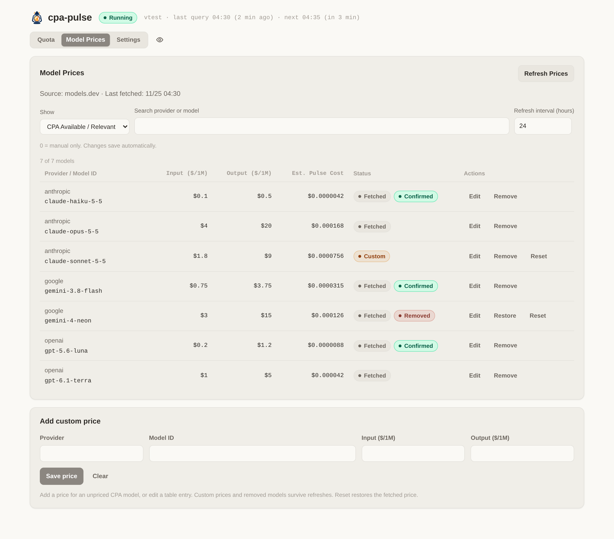

# Usage

cpa-pulse is a native plugin for [CLIProxyAPI](https://github.com/router-for-me/CLIProxyAPI) (CPA). It monitors the quota of ChatGPT (Codex), Claude, Antigravity, Kimi and Grok accounts, sends alerts through [Bark](https://github.com/Finb/Bark) or a generic webhook, and sends a minimal request after enabled short (5-hour) or long (7-day/30-day) quota windows reset so that the next cycle starts.

## Features

- **Quota monitoring**: queries quota on a schedule and also reads the quota that upstream providers return while CPA serves real requests.
- **Notifications** through Bark or a webhook (Feishu, ntfy, DingTalk, Telegram and others): alerts when remaining quota drops to 50%, 20%, 10% and zero, and when the plan of an account changes, for example when a subscription expires; optional recovery and pre-reset reminders; optional forwarding of [Did Codex Reset](https://didcodexreset.com/) signals.
- **Window ignition**: from 07:00 to 22:30, sends one minimal request per quota group when enabled windows are due, 3 seconds after a fixed reset. The request uses CPA's model executor, is pinned to one account and serves all due windows in that group.
- **Management page**: shows quota, ignition plans, events, burn-rate charts and Model Prices in the CPA Management Center, and edits settings and price overrides.

| Service | Monitored | Ignition by default |
| --- | --- | --- |
| ChatGPT / Codex | 5-hour, 7-day and 30-day windows when reported | On, short and long windows |
| Claude | 5-hour and 7-day windows, plus separately counted quotas such as Fable | On, main short and long windows; scoped pools such as Fable stay monitor-only |
| Antigravity | Quota groups such as Gemini and Claude / GPT | Off; when on, Gemini only |
| Kimi | 5-hour, 7-day and other windows | Not supported: the windows switch at fixed times |
| Grok | 7-day window | Not supported: a new period starts when the previous one ends |

Kimi quota queries follow the CPA Management Center; parsing is tested with a real response a user provided, but the requests have not run against a real account yet. Grok accounts billed by API usage have no quota to read and show an error. Accounts without a 5-hour window can still pulse a supported long window. Kimi and Grok (xAI) stay monitor-only regardless of window settings.

Notifications and the page name the quota group of ChatGPT accounts `GPT`, so that it does not start with the same letter as Claude. When a service has several accounts, notifications and the page tell them apart by the last two characters of the email user name, for example `GPT#rk`. A named account shows its name instead, for example `GPT#main`. To name an account, fill in "Name" in the "Accounts" section of the cpa-pulse settings view, or edit the credential's "Note" in the CPA Management Center. The name is the first line of the note, cut at 20 characters. A service with one account also shows its name. When a name equals the name or email suffix of another account of the service, the email suffix follows the name. For a note with more lines, clearing the name in the cpa-pulse page deletes the whole note. A note changed in the CPA Management Center takes effect after the next poll or a manual refresh. Recorded events keep their original label.

When a service has several accounts, the total in the chart averages their remaining quota by weight; the weight says how many times the quota of the service's cheapest paid plan the account has. The default weight follows the detected plan, whose name shows at the bottom of the account card. The ChatGPT plan comes with the quota query. The Claude and Antigravity plans are read from the account profile once a day per account, and again at once when the account starts or stops reporting a quota window, for example when the 5-hour Gemini window disappears after Google AI Pro expires. A failed read keeps the plan read before, and the weight is 1 until a plan has been read. The "Weight" field in the "Accounts" section of the settings view sets a weight by hand, decimals allowed; leave it empty to restore the plan default shown in the field. Weights set by hand are saved in `account_weights` and take precedence over the defaults. A weight other than 1 shows after the account title, for example `×5`.

| Service | Plan | Default weight |
| --- | --- | --- |
| ChatGPT | Free, Go | 0.1 |
| ChatGPT | Plus, Business, Enterprise, Edu | 1 |
| ChatGPT | Pro $100, Business Premium | 5 |
| ChatGPT | Pro $200 | 10 |
| ChatGPT | Pro $500 | 25 |
| Claude | Pro, Team, Enterprise | 1 |
| Claude | Max 5x | 5 |
| Claude | Max 20x | 20 |
| Antigravity | Free, Pro, Ultra | 1 |

Other services and unknown plans default to 1.

When the plan of an account changes, for example when Google AI Pro expires or is renewed, the plugin sends a 🎫 notification such as `🎫 Antigravity · plan Pro → Free`. Quota alerts of the account then start over with the quota of the new plan: it is only recorded, not reported as a recovery or a drop. The first plan read for an account is only recorded. The Claude plan is read once a day; after a Claude plan changes and before the new plan is read, quota alerts still compare with the quota of the old plan. The same happens when the plan changes later than the quota windows, or when reading the plan keeps failing for more than an hour, which can send one false recovery or drop alert.

## Requirements

- CPA v8.0.4 or later with plugins enabled (`plugins.enabled: true`). The plugin is built for Linux amd64/arm64, macOS amd64/arm64 and Windows amd64; the macOS builds have not been tried on a running CPA.
- A CPA API key reserved for cpa-pulse. The plugin reads the model list with it to pick ignition models.
- For notifications, an iPhone with Bark or a service that accepts webhooks.

## Installation

1. Download the zip for the system CPA runs on from [Releases](https://github.com/NotRllyRn/cpa-pulse/releases): on Linux, `linux_amd64` when `uname -m` prints `x86_64` and `linux_arm64` when it prints `aarch64`; `darwin_arm64` for Apple silicon Macs, `darwin_amd64` for Intel Macs; `windows_amd64` for Windows.
2. Extract the library (`cpa-pulse-v<version>.so` on Linux, `.dylib` on macOS, `.dll` on Windows) into the `<os>/<arch>/` folder of the CPA plugin directory, for example `plugins/linux/arm64/` or `plugins/windows/amd64/`. In a Docker deployment the plugin directory is the host folder mounted at `/CLIProxyAPI/plugins`.
3. Add an API key to CPA's `config.yaml` and enable the plugin:

   ```yaml
   access:
     api-keys:
       - "existing key"
       - "new key for cpa-pulse"
   plugins:
     enabled: true
     configs:
       cpa-pulse:
         enabled: true
         models_api_key: "new key for cpa-pulse"
         bark_url: "https://api.day.app/your_device_key"
   ```

4. Restart CPA (`docker compose restart` in a Docker deployment). The plugin runs its first query about 20 seconds after CPA starts.
5. Open **cpa-pulse** in the Management Center sidebar. If you signed in to the Management Center with "remember password", the page uses that key; otherwise it asks for one.

The plugin checks for a new version every 6 hours and whenever the management page opens. When a new version is out, a green up arrow appears to the right of the version in the management page header; clicking it opens the release page. To upgrade, update the plugin in the plugin store of the CPA Management Center; for a manual install, put the new library in the same folder, delete the old one and restart CPA.

The plugin keeps its state and quota history in `data/cpa-pulse/` under the plugin directory. In a Docker deployment that directory is on the host, so recreating the container keeps the data.

## How quota is read

**Active queries** run every 5 minutes by default, at minutes `00 / 05 / 10 / ... / 55` of each hour. In addition, the plugin queries the account once 30 seconds before and once 30 seconds after each quota window resets: the first records what is left at the end of the cycle, the second confirms the new cycle and sends the recovery notification without waiting for the next poll. A query is skipped when a newer reading already exists. Queries use the same URLs and headers as the quota page of the CPA Management Center.

**Passive data**: when a Claude or Codex model request passes through CPA, the provider returns the current quota in the response, and the plugin uses it without an extra request. Antigravity, Kimi and Grok return no such data and are only queried actively. A window that only appears in the response headers and not in the usage API is no longer shown after an active query, such as the 5-hour window of a ChatGPT Pro account.

If an account produced passive data in the 60 seconds before a scheduled query, that query is skipped for the account. An account is skipped for at most 30 minutes in a row; after that it is queried actively, so that quotas missing from the response headers, such as an unused Claude Fable quota, stay current. The chart does not draw this planned interval as missing data.

Claude and Codex quotas have 1% precision, whether queried or read passively. Antigravity queries return decimals, and so can Kimi, whose percentage is computed from used and limit counts.

When an upgrade removes a window and a downgrade brings it back, its first returning reading only establishes a new alert baseline, without recovery or pre-reset notifications. Disappearance sends no notification. Absence confirmed by an active query persists across plugin restarts. Passive response headers cannot restore an absent window; only a later successful active query can restore it. When reading an older state file, the plugin attempts to recover the last actively confirmed window set. Existing quota groups whose set cannot be recovered wait for a successful active query; response headers cannot add windows to those groups in the meantime. An absent window is not ignited; ignition resumes automatically when it returns and its class is enabled. History retains retired windows.

**Network exit**: active queries leave through the same exit that CPA uses for model requests of the account: the account's `proxy_url`, then the global `proxy-url`, then proxies from environment variables, then a direct connection. When an account's `proxy_url` cannot be parsed, the plugin skips the query instead of connecting directly.

## Window ignition

Supported usage-triggered windows start with a request after reset. cpa-pulse pulses short (5-hour) and long (7-day/30-day) windows by default. Set `ignition.windows` to `["short"]` or `["long"]` to select one class; `[]` disables automatic pulsing. Provider and quota-group switches still apply. Kimi and Grok stay monitor-only. The rules:

- Times use the plugin time zone, which follows the CPA server by default.
- Automatic requests run from `07:00` to `22:30`. A fixed window becomes due 3 seconds after its reset; a due time outside those hours waits until the next opening. A future long-window reset never causes an earlier daily pulse.
- The request asks the model to reply `OK`, declares no tools and sets no output-token limit. The first nonempty streamed output (text, visible reasoning or tool arguments) starts an independent 2-second timer that closes the upstream stream. A stream that ends sooner is cleaned up immediately. Heartbeats and lifecycle events do not start the timer, and this deliberate cutoff does not trigger model fallback.
- One request per group serves all windows due at that time. Each window confirms independently from a fresh, fixed future reset. A confirmed window keeps its progress if another remains unconfirmed; the same serviced stale reset is not pulsed again. Long windows need a known reset before scheduling.
- Models use [cheapest-model selection](#model-prices). Account/group overrides take precedence over provider/group overrides, then automatic selection. Manual model choices are strict: failure never silently switches models.
- Automatic selection allows at most two upstream attempts total for a model-specific refusal, including 403/404 entitlement or missing-model errors. Generic permission errors, authentication, suspension, rate limits and network failures do not switch models. Refused models are skipped for that account/group for 24 hours, across restarts.

Before the first output, waiting follows CPA's own behavior; `request_timeout_seconds` does not limit model startup. Stopping the plugin closes requests whose stream IDs are available; a request still starting must wait for CPA to return its stream ID. See [Streaming and cancellation](architecture.md#streaming-and-cancellation) for these limits.

After each model call, the CPA server log records the service, model, correlation identifiers, received text, host-reported usage and its completeness, end reason, time to first output and total duration. Text, including visible reasoning and tool arguments, is capped at 4096 Unicode characters and marked when truncated. Usage retains CPA's numbers without estimating tokens. CPA translation may fill missing counters with zeros or combine token categories, so Antigravity usage is marked partial even after a natural end. Other completeness labels describe host-protocol accounting only; they do not guarantee that all upstream usage or breakdowns were returned. Records exclude credentials, full requests and encrypted reasoning, and are not added to page events or quota history.

**Failure protection**: the retry and pause rules below apply to scheduled ignition. A failed "Ignite now" request only displays the error and records an event. It does not retry automatically, count toward failure protection, or change the existing automatic schedule. Successful manual ignition is recorded as usual.

- An invalid credential (such as 401) or a suspended account (such as Google's `TOS_VIOLATION`) stops scheduled ignition for that account without daily retries, with one 🔑 or ⛔ notification (the suspension notice includes the appeal link). Ignition resumes after you log in again or update the credential, or after a successful "Ignite now". Quota queries also report lasting authentication failures (3 in a row over at least 30 minutes) and suspended accounts; ignition and queries report the same problem once, also across plugin restarts. When the problem ends, a ✅ credential notification follows.
- Rate limits (429), unavailable models, or a request that succeeded without starting the window pause ignition for that quota group until 07:00 the next day, with one notification; for rate limits it is ⏳ rate limited. Notifications carry only the first sentence of the provider's error; the full error is in the event details on the page.
- Network and server errors are retried after 5 and 15 minutes; a third failure also pauses until the next day.
- When the quota ran out before the reset, CPA cools the account down until a dozen or so seconds after the reset. An ignition that hits this cooldown retries as soon as it ends and is not counted as a failure.
- When any quota window is used up, scheduled ignition for the quota group waits for its reset and recovery; the page identifies the exhausted window. "Ignite now" still works.
- When the quota comes back early, for example after a reset card, while CPA still cools the account down until the original reset, CPA rejects every request and ignition in between. The plugin sends one ⚠️ notification and shows a note on the account card; clear the account's cooldown in the CPA Management Center.

## Management page

Use the "Quota | Settings | Model Prices" switch at the top to change views. The browser remembers the last view. The quota view shows:

- the quota windows of each account with reset times (including the weekday), data sources and plan, with a button to refresh each account;
- five color levels shared by quota bars and charts: full at a raw remaining value of 100%, empty at 0%, and high, medium and low between them, split by the first two alert thresholds; 99.6% does not use the full color even when rounded to 100% for display;
- the next ignition and current reset (both with the weekday), last result and failure protection state of each quota group, with an "ignite now" button; hidden while ignition is off;
- a quota chart:
  - It shows the 5-hour quota, over 1, 3, 6, 12, 24 or 26 hours (6 by default), the 7-day quota, over 1, 4, 8 or 15 days, one month (from this date last month) or 36 days (8 days by default), or the 30-day quota, over 1, 15, 31, 61, 90 or 151 days (31 by default). Available history is limited by `history_retention_days` (40 by default). Window kinds and chart rows include current windows and windows with samples in the selected history range. A current window without new samples in the range keeps its row, with missing intervals marked as no data. Windows of other lengths only show on the account cards. With `remember_chart_filters` ("Remember the window, range and order") on, the page keeps the last choices in the current browser.
  - 1 and 3 hours and 1 and 4 days end now. Longer ranges end at the reset of the selected row's current window; 6 hours, for example, shows the current 5-hour window and the last hour of the previous one, with the time after now hatched. When the selected row has no reset, or its reset has passed (a 5-hour window no request has opened yet), these ranges also end now.
  - The top part has one colored band per service, colored like the quota bars by the lowest reading so far in each cycle. The default order follows the account cards: each service takes the position of its first account, and groups within the same account keep their group order. You can also sort by lowest remaining. A service with several accounts shows their weighted total; clicking the selected total expands it into one row per account. With `remember_chart_expanded` ("Remember expanded groups") on, the page keeps the expanded groups in the current browser, one shared set for all window kinds. While one account is missing data, the total estimates that account from its readings and its scheduled reset, and the detail chart draws that stretch dashed; while the latest total is estimated, no projection is drawn.
  - A window the account no longer reports is marked "Inactive" until its last sample leaves the selected range. It gets a separate row and is excluded from totals and lowest-first ordering. Its curve ends at the last reading, without an even-pace line or projection.
  - The bottom part plots the selected row with its resets and ignition results. Its even-pace line uses the scheduled reset recorded at each time and a fixed 5-hour, 7-day or 30-day length, falling linearly from 100% to 0% at that reset. An early reset cuts the old reference where the new reset is first observed and starts a reference for the new schedule. No reference is drawn while the reset is unknown. If the current window loses its reset time, the reference stops at the chart’s current-time boundary instead of extending toward the previous reset. The reference value is null at that boundary, and the single-account and total headers show “—” for both even pace and difference. A curve above the reference is using quota slower than an even pace. A total shows the weighted mean reference only while every account has a reference value. Its header shows the current remaining, the even-pace value now and the difference between them, green above the pace and red below. When the chart ends now, these three values also appear right of the plot, at the ends of the curve and the even-pace line. When the scheduled reset moves within a cycle, the new reference is extended back as a dash-dot line to the start of the cycle, where the quota rose back. When the chart is wide enough, its heading sits as a column in the blank left of the plot.
  - When the chart ends at a reset, a projection starts now: if the quota runs out first, the time (and the date for long quotas) is marked on the time axis; if the reset comes first, what will be left is marked right of the plot.
    - The 5-hour quota is projected at the current rate, showing where use at that rate would lead. The rate comes from the latest stretch of steady use in this cycle, so in the first minutes of heavy use the projected time comes too early.
    - The 7-day and 30-day quotas are projected at this cycle's daily average: what the cycle has used so far over the time since it began, including the time without use. In the first day or two of a cycle the projection is less accurate.
  - The page reads the status every 30 seconds and updates the chart when there is new data; while the pointer is over the chart, the update waits until it leaves.
- recent events in columns for time, type, quota group and detail. A notification triggered by an event shows as "Notified" or "Notification failed" at the end of that event's row instead of a row of its own. Resets of 5-hour quotas are hidden until "Show 5-hour resets" is checked; the browser keeps the choice.

The eye buttons at the top of the page, in the cards header and in the detail-chart header share the "Blur accounts" and "Show accounts" switch. It blurs current account identifiers, including names, emails and input fields in the "Accounts" settings section, and old names retained in events and history charts, including labels of renamed or deleted accounts and internal group identifiers of history that cannot be associated with a current account. Orphan history rows are blurred in the overview, detail, data table and screenshots; screen-reader labels use account numbers. Upstream errors and older event details that cannot be reliably split are blurred as a whole. The choice is saved in the current browser and survives reloads; each computer and browser keeps its own. Confirmation dialogs, such as clearing an account name, still show the original text. Blurring affects display only and does not remove the original data from API responses or the page.

Each account card places "Refresh" and the camera button at the bottom right, in that order, beside the plan information on the left. Cards without plan information show only the right-aligned buttons. The card heading contains the service label and email.

Camera buttons on each account card, in the cards header and in the detail-chart header copy one card, all cards or the detail chart to the clipboard as a PNG. Screenshots retain the current theme and blur state and omit action buttons. This requires a browser with image-clipboard support, a secure context such as HTTPS or localhost, and clipboard permission. Unsupported browsers disable the buttons.

The settings view contains "Accounts", "Notification channels", "Alert rules", "Ignition", "Services" and "Advanced", in that order. The "Accounts" section lists accounts in their current order. Names and weights save when you leave the field or press Enter and share the heading result with order changes; failure handling is described under [Configuration](configuration.md). Drag a handle to save the order in `account_order`, which sets the default order of quota cards and charts. Press Esc during a drag to cancel.

Webhook configuration and message templates are described under [Webhook](configuration.md#webhook).

"Send test" in the notification settings waits for pending saves and then uses the configuration token to wait up to 15 seconds for the plugin to confirm application; a hanging status request does not extend this wait. After confirmation it sends to every configured channel and shows each result; on timeout it reports "The new settings are not in effect yet, so the test was not sent" and sends nothing. An empty ignition model field shows the model the next ignition will use in its hint; for Antigravity, the model of the Gemini group. Services that cannot be ignited show "No ignition". The plugin checks its CPA model list at startup, on `cpa_base_url` or `models_api_key` changes and during ignition. Successful lists are cached for 10 minutes; a newly listed model becomes selectable after a later ignition refreshes that cache.

The management page uses English.

## Model Prices



Open "Model Prices" to search the catalog, filter CPA-relevant models, and inspect input/output USD per million tokens, estimated pulse cost and eligibility. "Refresh Prices" fetches the models.dev v1 catalog in the background. The refresh interval defaults to 24 hours; set it to `0` for manual refresh only, or `1–168` hours.

The table displays at most 200 rows after filtering; narrow your search to see more models. The page refreshes price data every 30 seconds, pausing while the search field has focus or you are editing a price.

The plugin loads `model_prices.json` and `model_price_overrides.json` from `data_dir` first, with an embedded offline fallback. Failed refreshes keep usable local prices. Pulses never fetch pricing synchronously. Automatic selection ranks compatible CPA models by the estimated cost of 32 input and 2 output tokens; this is a ranking estimate, not a bill. It excludes removed, deprecated and non-text-generation models. If none has a usable price, provider ordering supplies the fallback while retaining those exclusions.

Use "Edit" or "Add custom price" to set both prices; zero is valid. "Remove" stores a disabled-model tombstone that survives catalog refreshes; editing its prices keeps it removed until "Restore" or "Reset". "Restore" enables it again. "Reset" deletes the local override and restores the catalog entry; an override-only model disappears. Price overrides affect automatic ranking. Choose an account's pulse model on its quota card to set `account_models[authID][groupKey]`, or choose "Auto (Cheapest)" to clear that account override; provider/group choices still take precedence over automatic ranking. The card distinguishes "Estimated cheapest", "Confirmed cheapest" and "Manual override".

See [Pricing and model overrides](configuration.md#pricing-and-model-overrides) for configuration and [Model prices API](architecture.md#model-prices-api) for endpoints.

## Security and risk

- The plugin reads the access token from the credential file into memory only to query quota, and never writes it to logs or disk. The page's data API requires the CPA management key; MCP uses its own key.
- `bark_url`, `webhook`, `models_api_key` and `mcp_key` are stored in plain text in CPA's `config.yaml`, visible to anyone with the management key.
- Each service restricts the use of subscription accounts through third-party tools in its own way. Using accounts through CPA, sending scheduled ignition requests and querying quota may all put accounts at risk. Use it at your own discretion.

## Documentation

- [Configuration and notifications](configuration.md)
- [MCP clients, proxy setup and tools](mcp.md)
- [Architecture, API and storage](architecture.md)
- [Development, tests and releases](development.md)

## Troubleshooting

| Symptom | Check |
| --- | --- |
| Plugin missing from the sidebar | CPA version, `plugins.enabled`, library platform and `<os>/<arch>/` placement; restart CPA after installation. |
| Quota empty just after startup | Allow about 20 seconds for initialization and the first full query, then use Refresh. |
| Ignition has no model | Set a dedicated CPA API key in `models_api_key`, check `cpa_base_url` and `/v1/models`, and confirm the model is available to the selected account. |
| Settings saved but unconfirmed | Read the save result and MCP listener error. A 15-second confirmation timeout does not prove the configuration failed; refresh status before testing. |
| Notification missing | Check channel URLs, run Send test, and inspect each result. For APIs that return HTTP 200 on application errors, configure `success_json`. |
| Account reports authentication or suspension errors | Update its credential or log in again. A successful manual ignition clears a confirmed ignition problem. |
| Quota recovered but requests still fail | Check CPA cooldowns; clear an obsolete cooldown in the Management Center. |
| MCP unavailable | Check its dedicated key, listen address and listener error; Docker loopback is inside the container. See [MCP](mcp.md). |
| PNG copy unavailable | Use HTTPS or localhost with image-clipboard support and clipboard permission. |

## Coexistence and limitations

cpa-pulse uses its own plugin ID `cpa-pulse`, configuration subtree `plugins.configs.cpa-pulse`, management route `/v0/management/cpa-pulse`, resource route `/v0/resource/plugins/cpa-pulse/page` and default data directory `data/cpa-pulse/` under the plugin directory. Its MCP listener defaults to `127.0.0.1:8319`. These separate names, paths and port allow it to run alongside Lamplighter. Configure each plugin independently and keep any explicit `data_dir` paths separate. Running both against the same accounts can still send duplicate alerts and quota or ignition requests.

Existing user history, account names and upstream errors are preserved verbatim. Historical event text may retain its original wording. Account blurring only affects display; it does not redact API responses, DOM text or confirmation dialogs. MCP uses its own masked account labels.

Quota queries and ignition depend on upstream subscription behavior and CPA routing. Forecasts describe continued use at the measured rate and cannot guarantee future quota or account selection. See the service-specific limits above and [Streaming and cancellation](architecture.md#streaming-and-cancellation).

## License and attribution

cpa-pulse is derived from **Lamplighter**, created by [PosvdM](https://github.com/PosvdM). The original project is [cpa-plugin-lamplighter](https://github.com/PosvdM/cpa-plugin-lamplighter). The source for this version is [NotRllyRn/cpa-pulse](https://github.com/NotRllyRn/cpa-pulse).

[AGPL-3.0-or-later](../LICENSE). Preserve upstream attribution and license notices. Distribution and network use of a modified version carry the source-sharing obligations described in the license.
